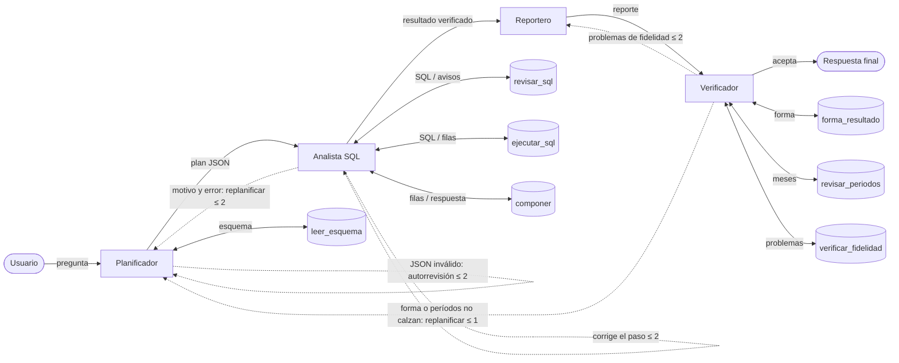

# Asistente SQL4Business

### Asistente de Consultas de Negocio: SQL y Reportes Ejecutivos Fieles a los Datos

Generative Artificial Intelligence (580694), Universidad de Concepción.

**Equipo:** Aredhel Jiménez, Bryan Riquelme, Guido Salazar y Vicente Soñez.

| Entregable | Documento | Reproducción |
|---|---|---|
| Deliverable 1 | [`docs/deliverable1.pdf`](docs/deliverable1.pdf) | [`notebooks/baseline_eval.ipynb`](notebooks/baseline_eval.ipynb) |
| Deliverable 2 | [`docs/deliverable2.pdf`](docs/deliverable2.pdf) · [video](https://drive.google.com/file/d/1ovemshyIkbVYasXr7zaFDXIrdrHN7OH5/view) | [`notebooks/deliverable2_demo.ipynb`](notebooks/deliverable2_demo.ipynb) |
| Deliverable 3 | [`docs/deliverable3.pdf`](docs/deliverable3.pdf) · video: _(enlace pendiente)_ | [`notebooks/deliverable3_demo.ipynb`](notebooks/deliverable3_demo.ipynb) |

## Definición de la tarea

Se propone un asistente que, dada una pregunta de negocio, decide y ejecuta las consultas
SQL necesarias y redacta un resumen fiel a los resultados obtenidos. La pregunta puede ser
puntual, o combinada: en ese caso hay que identificar, relacionar y ejecutar varias
consultas para razonar cuál es la respuesta correcta. Una salida se considera correcta
cuando las consultas ejecutadas son las necesarias y suficientes para responder la pregunta,
y cuando cada cifra del resumen final es fiel a esos resultados.

Text-to-SQL es una tarea muy estudiada, pero la literatura casi siempre se detiene en la
exactitud de una única consulta. Este proyecto la extiende en dos direcciones poco
exploradas en modelos abiertos pequeños: planificar qué consultas se necesitan para
preguntas que combinan varios datos, y la fidelidad numérica del reporte.

## Datos

- `data/business.db`: base SQLite sintética de ventas e inventario (10 productos, 549
  ventas entre el 1 de marzo y el 31 de agosto de 2026), generada con semilla fija por
  `data/build_db.py`.
- `data/questions.json`: las 15 preguntas oficiales de Deliverable 1 (10 puntuales y 5
  combinadas), con el SQL y el resultado de referencia. No cambiaron. Solo se agregó
  `answer_fields` a q11, porque esa pregunta pide dos conteos y no un porcentaje.
- `data/paraphrases.json`: 12 paráfrasis de preguntas oficiales, 5 puntuales y 7
  combinadas (2 en inglés), con el mismo SQL y la misma respuesta de referencia. Es el
  conjunto externo (held-out): se escribió durante la auditoría y no se usa para diseñar
  el sistema.

Ambos JSON los genera `data/build_questions.py`, que ejecuta el SQL de referencia sobre
`business.db`.

## Deliverable 3: sistema de agentes

El Deliverable 3 reconstruye la solución del D2 como un sistema de **cuatro agentes**. Cada agente
es una llamada al mismo modelo (`Qwen/Qwen2.5-Coder-3B-Instruct`, NF4 de 4 bits, greedy, Colab T4)
con un rol, un prompt propio guardado como archivo versionado en [`prompts/`](prompts/), una entrada
y una salida definidas, y una decisión sobre qué pasa después. Las piezas deterministas del D2
(esquema enriquecido, SQL de solo lectura, composición, verificación de fidelidad) pasan a ser
herramientas de los agentes; el código del D2 (`pipeline.py`) no cambia y se sigue evaluando.



### Agentes

| Agente | Prompt | Recibe | Devuelve | Herramientas | Decide / se detiene |
|---|---|---|---|---|---|
| Planificador | [`planificador.md`](prompts/planificador.md) | pregunta, esquema, retroalimentación opcional | plan JSON: pasos SQL y operación (+ lo que pide la respuesta y los períodos) | `leer_esquema` | entrega el plan al Analista; si su JSON es inválido, revisa su propia salida (≤ 2) |
| Analista SQL | [`analista_sql.md`](prompts/analista_sql.md) | plan JSON | filas por paso y respuesta compuesta, o un motivo para replanificar | `revisar_sql`, `ejecutar_sql`, `componer` | solo llama al modelo si una herramienta falla: corrige el paso (≤ 2 por plan) o devuelve el plan al Planificador (≤ 2 replanificaciones) |
| Reportero | [`reportero.md`](prompts/reportero.md) | pregunta, resultado verificado, problemas opcionales | una o dos oraciones en el idioma de la pregunta | — | entrega al Verificador; reescribe si el Verificador lo rechaza (≤ 2) |
| Verificador | [`verificador.md`](prompts/verificador.md) | pregunta, resultado, reporte | veredicto: aceptar, revisar el reporte o replanificar | `forma_resultado`, `revisar_periodos`, `verificar_fidelidad` | el modelo lee solo la pregunta y declara qué tipo de respuesta pide y qué períodos nombra; si el resultado no calza, devuelve el caso al Planificador (≤ 1); si el reporte no es fiel, al Reportero; si no, acepta |

Por qué esta división: entender la pregunta, interactuar con la base, redactar y juzgar son
competencias distintas, y quien juzga no debe ser quien produjo el trabajo. Cuando se agotan los
presupuestos, el sistema entrega la mejor respuesta anterior (estado `respaldo`) o declara que no
pudo responder. Código: [`src/sql4business/agents.py`](src/sql4business/agents.py).

### Técnicas de prompting y ablación

Clasificadas con la taxonomía de Schulhoff et al. (2024) [7]. Todos los agentes usan *role
prompting* y salida estructurada. Cada técnica está marcada como un bloque `[[técnica]]` en el
archivo del prompt (o como una rama del código) y se puede apagar por separado:

| Técnica | Agente | Falla que ataca (D2) | Configuración sin ella |
|---|---|---|---|
| Few-shot: tres ejemplos resueltos que no pertenecen a ningún conjunto de evaluación [8] | Planificador | listados en vez del primero (q03), `strftime('%Q')` (q10) | `sin_few_shot` |
| Descomposición explícita (*plan-and-solve*): qué debe contener la respuesta y los períodos antes del SQL [9] | Planificador | una sola consulta para preguntas de varios valores (q11, q09-p) | `sin_decomposition` |
| Autocorrección guiada por herramientas (*self-debugging*): el error de SQLite, del linter o de la composición vuelve al modelo [10] | Analista SQL | filtros de fecha y sintaxis (q09, q10) | `sin_self_correction` |
| Verificación con lista de chequeo (*self-verification*) [11] | Verificador | resultados válidos que no responden la pregunta (q03, q11, q09-p, q14-p) | `sin_critic` |
| Refinamiento con retroalimentación (*self-refine*) [12] | Reportero | cifras no respaldadas en el reporte (q13) | `sin_report_refine` |

`tests/test_agents.py` reproduce los planes que fallaron en la corrida v3 del D2 y comprueba que las
herramientas los devuelven al agente que corresponde.

### Trazas

Cada pregunta deja una traza con todos los mensajes entre agentes y herramientas, en orden:
`n`, `de`, `para`, `tipo`, `contenido` y, cuando corresponde, la `salida_modelo` cruda.

- `results/deliverable3/trazas/<set>_<id>.json`: una por pregunta del sistema completo (incluye el
  caso de falla).
- `results/deliverable3/demo/<id>.json`: las preguntas que se muestran en el video.

### Evaluación del Deliverable 3

Ocho configuraciones sobre las mismas 27 preguntas y con el mismo criterio (`sql`, `answer`,
`report`, `e2e`, definidos en la evaluación del Deliverable 2): `baseline` (prompt directo del D1), `d2` (solución del D2),
`agentes` (sistema completo) y una ablación por técnica (`sin_<técnica>`). También se informa el
promedio de llamadas al modelo por pregunta.

**Resultados:** _pendientes de la corrida en Colab_ (`results/deliverable3/*.json` y la tabla
[`docs/deliverable3_results.tex`](docs/deliverable3_results.tex)).

### Cómo reproducir el Deliverable 3

1. Abrir [`notebooks/deliverable3_demo.ipynb`](https://colab.research.google.com/github/aredhel-jmze/Asistente-SQL-4-Business/blob/main/notebooks/deliverable3_demo.ipynb)
   en Colab con GPU T4.
2. **Prueba corta** (unos 5 minutos): `python scripts/evaluate_d3.py --limit 2 --configs agentes`.
3. **Demo del video**: `python scripts/run_agents.py --id q09-p` imprime en vivo cada mensaje entre
   agentes, con la baseline sobre la misma entrada, y guarda la traza. `--without critic` (u otra
   técnica) muestra el sistema sin esa técnica.
4. **Evaluación completa** (unas 2 horas): `python scripts/evaluate_d3.py --resume`. Si Colab se
   desconecta, la misma orden continúa desde la última configuración guardada.
5. **PDF**: `cd docs && pdflatex deliverable3.tex` (incluye la tabla generada).
6. **Tests sin GPU**: `python -m unittest discover -s tests`. Usan un modelo simulado
   (`tests/oracle.py` y respuestas guionadas) para probar los agentes, los ciclos, las trazas y la
   evaluación de punta a punta.

### Desviaciones declaradas del Deliverable 3

- Nueva herramienta `revisar_sql`: un linter que detecta comparar `strftime('%Y-%m', ...)` con fechas
  completas, el error silencioso del caso de falla del D2 (q09).
- El prompt del Reportero agrega una regla: no mencionar pasos, SQL ni ids (en el D2, "paso 1" en
  q13 contaba como cifra no respaldada).
- Los ejemplos del Planificador y del Verificador usan la misma base, pero ninguna pregunta de los
  conjuntos de evaluación (un test lo comprueba). Cubren los mismos tipos de operación, por lo que su
  aporte se mide con la ablación `sin_few_shot`.
- La baseline y la solución del D2 se vuelven a correr sin cambios en la misma sesión, para comparar
  todo con las mismas versiones.

## Sistema (Deliverable 2)

**Modelo:** `Qwen/Qwen2.5-Coder-3B-Instruct`, cuantizado en NF4 de 4 bits con cómputo
bf16 y decodificación greedy, en una GPU T4 de Colab (el hardware declarado en
Deliverable 1). Es el menor de los tres candidatos y empató el mejor baseline propio
(46,7 %). Qwen-7B cuesta más parámetros sin ventaja local, y Llama-3.1-8B es mayor,
requiere acceso restringido y obtuvo el mismo 46,7 %.

**Intervención contra el fallo diagnosticado.** En Deliverable 1, el prompting directo
obtuvo 0/5 en preguntas combinadas. Los errores eran fechas inventadas, categorías
traducidas, sintaxis de otros motores y tratar una pregunta combinada como una sola
consulta. La solución separa planificar de calcular:

```
pregunta ─► esquema enriquecido ─► plan JSON (Qwen 3B) ─► SQL de solo lectura ─► composición ─► reporte (Qwen 3B) ─► verificación
            valores exactos,        pasos + operación      validación; un paso   determinista    idioma de la       cada cifra debe
            rango de fechas, joins  elegida por el modelo  puede leer otro;      (crecimiento,   pregunta           salir de la
                                         ▲                 reparación ≤ 2        participación,                     respuesta
                                         └──── error ◄─────┘                     comparación, filtro+ranking)
```

- `src/sql4business/sql_tools.py`: esquema enriquecido y ejecución de solo lectura
  (conexión `mode=ro`, validación que ignora literales, rechazo de años sin datos).
- `src/sql4business/pipeline.py`: plan, ejecución con referencias entre pasos (como
  CTE), composición, reporte y hasta dos reparaciones con el mensaje de error.
- `src/sql4business/composition.py`: operaciones deterministas; los errores de forma
  activan la reparación.
- `src/sql4business/fidelity.py`: verificación del reporte. Toda cifra debe coincidir con
  la respuesta verificada o con la evidencia (pregunta, SQL, filas) a la precisión en que
  está escrita, y se controla la dirección del cambio y la afirmación de si "cambió".
  Si el modelo no entrega un reporte válido, se muestra un resumen determinista y cuenta
  como fallo.
- `src/sql4business/evaluation.py`: evaluación compartida por el script y el notebook.

## Evaluación (Deliverable 2)

Se comparan tres sistemas sobre las mismas entradas y con los mismos criterios:

| Sistema | Qué es |
|---|---|
| Baseline | Prompt directo de Deliverable 1, literal, con el esquema simple |
| Alternativa | El mismo prompt directo con el esquema enriquecido |
| Solución | El pipeline estructurado |

| Métrica | Criterio |
|---|---|
| `sql` | Criterio de Deliverable 1: cada conjunto de filas de referencia es producido exactamente por alguna consulta ejecutada |
| `answer` | La respuesta final es correcta, sin importar cómo se llegó a ella. Por ejemplo, una sola consulta que devuelve el producto ganador cuenta |
| `report` | (solo solución) el reporte escrito por el modelo pasa la verificación de fidelidad |
| `e2e` | (solo solución) `answer` y `report` correctos a la vez |

### Resultados

Corrida v3: 24-09-2026, Colab T4, commit `d0c33b6`. Detalle por pregunta, trazas y
versiones en [`results/deliverable2_v3.json`](results/deliverable2_v3.json); la tabla del
PDF se genera desde ese archivo.

| Conjunto | Sistema | `sql` | `answer` | `report` | `e2e` |
|---|---|---|---|---|---|
| Oficial (15, in-sample) | Baseline (D1) | 7/15 | 8/15 | — | — |
| | Alternativa (esquema enriquecido) | 8/15 | 10/15 | — | — |
| | **Solución** | **11/15** | **11/15** | 12/15 | **10/15** |
| Paráfrasis (12, held-out) | Baseline (D1) | 3/12 | 5/12 | — | — |
| | Alternativa (esquema enriquecido) | 4/12 | 8/12 | — | — |
| | **Solución** | **8/12** | **10/12** | 11/12 | **10/12** |

- **Preguntas combinadas (`answer`):** en el set oficial, baseline 1/5, alternativa 1/5 y
  solución 2/5; en paráfrasis, 2/7, 4/7 y 5/7.
- **De dónde viene la mejora:** el esquema enriquecido explica casi toda la mejora en
  puntuales (9/10 respuestas oficiales, contra 7/10 de la baseline). La descomposición con
  composición determinista suma las combinadas.
- **Costo:** 16,3 s por pregunta, contra 6,2 s de la baseline, en T4.

### Casos de fallo y límites conocidos

- **q09 (caso de fallo principal):** el planificador filtra con
  `strftime('%Y-%m', sale_date) BETWEEN '2026-03-01' AND '2026-05-31'`. Comparar `'2026-03'`
  con una fecha completa deja fuera marzo y junio, así que el crecimiento calculado es 70,06 %
  en vez de 60,13 %. El SQL es válido, el resultado es un solo número y el reporte es fiel a
  él: ni la validación, ni la reparación, ni el verificador pueden detectarlo, porque
  revisan forma y cifras, no el significado de un predicado.
- **q10:** el modelo vuelve a usar `strftime('%Q')` en los tres intentos pese al mensaje de
  error; los reintentos no corrigen sesgos fuertes del modelo.
- **q03 y q11:** el plan no se limita al primer producto (q03) u omite el total (q11). En
  q09-p el planificador responde con un solo paso y el reportero inventa porcentajes, que el
  verificador rechaza.
- **Verificador:** controla cifras, no su atribución. Acepta "488" presentado como total
  (q11) y un id de producto sacado de un paso (q14-p). Además es conservador: rechaza
  "paso 1" en q13.
- **Validez:** los resultados oficiales son in-sample, y ambos conjuntos son chicos (27
  preguntas sobre datos sintéticos).

## Cómo reproducir (Deliverable 2)

1. **Todo lo del PDF y el video, en Colab:** abrir
   [`notebooks/deliverable2_demo.ipynb`](https://colab.research.google.com/github/aredhel-jmze/Asistente-SQL-4-Business/blob/main/notebooks/deliverable2_demo.ipynb),
   elegir `Runtime > Change runtime type > T4 GPU` y luego `Run all`. El notebook clona este
   repositorio en `REF`, instala `requirements.txt` (versiones fijadas), corre la demo y la
   evaluación completa (unos 20–25 minutos) y escribe `results/deliverable2_v3.json` y
   `docs/deliverable2_results.tex`. No hay que subir archivos ni tener cuenta en Hugging Face.
   La versión versionada del notebook ya incluye las salidas de la corrida v3.
2. **Tests sin GPU** (Python 3.8 o superior, sin dependencias):
   `python -m unittest discover -s tests`.
3. **Scripts con GPU:** `pip install -r requirements.txt` y luego:
   - `python scripts/run_question.py --id q09-p`: una pregunta, baseline y solución sobre
     la misma entrada; también acepta el texto de la pregunta.
   - `python scripts/evaluate.py --tex docs/deliverable2_results.tex`: la evaluación
     completa.
4. **PDF:** `cd docs && pdflatex deliverable2.tex`. La tabla de resultados la incluye
   desde `deliverable2_results.tex`.
5. **Datos:** `cd data && python build_db.py && python build_questions.py` regenera
   exactamente los archivos versionados.

Qué muestra el video: la celda de demo del notebook, que corre la baseline y la solución
sobre la misma pregunta (por defecto `q09-p`, la primera paráfrasis, sin elegirla por su
resultado), y el resumen de la evaluación.

## Estructura del repositorio

```
.
├── data/                 Base sintética, generadores y los dos conjuntos de preguntas
├── docs/                 PDF y fuentes LaTeX de D1, D2 y D3, tablas generadas, enunciado de D2
├── notebooks/            baseline_eval.ipynb (D1), deliverable2_demo.ipynb y deliverable3_demo.ipynb (Colab)
├── prompts/              Prompt de cada agente del D3, un archivo versionado por agente
├── results/              Resultados de D1, de D2 (v1, v2, v3) y de D3 (deliverable3/, con trazas)
├── scripts/              D2: evaluate.py, run_question.py · D3: evaluate_d3.py, run_agents.py
├── src/sql4business/     Código del asistente (D2: pipeline.py; D3: agents.py) y de la evaluación
├── tests/                Tests por módulo, sin GPU (modelo simulado)
└── artifacts/            Contexto de trabajo con IA y auditoría de D2
```

## Historial y desviaciones declaradas

- **Deliverable 1** (`results/baseline_*`): prompting directo con los tres candidatos,
  sobre las 15 preguntas oficiales.

  | Modelo | Puntual | Combinada | Global |
  |---|---|---|---|
  | Qwen2.5-Coder-7B-Instruct | 50 % | 0 % | 33,3 % |
  | Qwen2.5-Coder-3B-Instruct | 70 % | 0 % | 46,7 % |
  | Llama-3.1-8B-Instruct | 70 % | 0 % | 46,7 % |

- **Deliverable 2 v1** (17-09, `results/deliverable2_v1.json`): 12/15 con el criterio SQL.
  La auditoría ([`artifacts/auditoria-deliverable-2.md`](artifacts/auditoria-deliverable-2.md))
  encontró cuatro problemas:
  - el tipo de operación lo fijaba un clasificador con palabras copiadas de las 5 preguntas
    combinadas (0/7 en paráfrasis);
  - la baseline no era la de D1;
  - el criterio penalizaba respuestas correctas de una sola consulta;
  - el validador de reportes no medía fidelidad.
- **Deliverable 2 v2** (24-09, commit `2d99f37`, `results/deliverable2_v2.json`): corrige
  lo anterior. Elimina las reglas específicas de las preguntas, vuelve a la baseline de D1,
  agrega una métrica de respuesta común y un nuevo validador. En esa corrida el reportero
  descartó 5 reportes en texto plano por no ser JSON. En ese archivo el texto del reporte
  está en `raw_report`, porque la clave `report` guarda la métrica.
- **Deliverable 2 v3** (24-09, commit `d0c33b6`, `results/deliverable2_v3.json`, versión
  final): solo cambia el formato de salida del reportero, que acepta texto plano. El SQL y
  las respuestas son idénticos a v2 en las 27 preguntas.
- Las 15 preguntas oficiales se usaron para desarrollar el sistema (in-sample); la
  estimación de generalización es el conjunto de paráfrasis.
- **Cambio de plan respecto de D1:** D1 anunciaba fine-tuning QLoRA para este entregable,
  pero no se aplicó. Se optó por una intervención sin entrenamiento (planificación,
  herramientas y composición determinista), porque el fallo diagnosticado es de
  planificación y cálculo más que de conocimiento de SQL.
- **Idioma:** el documento técnico está en español; el reporte del asistente se escribe en
  el idioma de la pregunta.

## Referencias

1. CogniSQL-R1-Zero: Lightweight Reinforced Reasoning for Efficient SQL Generation. arXiv:2507.06013, 2025.
2. JudgeSQL: Reasoning over SQL Candidates with Weighted Consensus Tournament. arXiv:2510.15560, 2025.
3. TinyLLM: Evaluation and Optimization of Small Language Models for Agentic Tasks on Edge Devices. arXiv:2511.22138, 2025.
4. Mahapatra, Roy, Garain. Factual Inconsistency in Data-to-Text Generation Scales Exponentially with LLM Size. arXiv:2502.12372, 2025.
5. Hui, Yang, et al. Qwen2.5-Coder Technical Report. arXiv:2409.12186, 2024.
6. Li et al. Can LLM Already Serve as A Database Interface? A BIg Bench for Large-Scale Database Grounded Text-to-SQLs. NeurIPS 2023 (arXiv:2305.03111).

7. Schulhoff et al. The Prompt Report: A Systematic Survey of Prompting Techniques. arXiv:2406.06608, 2024.
8. Brown et al. Language Models are Few-Shot Learners. NeurIPS 2020 (arXiv:2005.14165).
9. Wang et al. Plan-and-Solve Prompting. ACL 2023 (arXiv:2305.04091).
10. Chen, Lin, Schärli, Zhou. Teaching Large Language Models to Self-Debug. arXiv:2304.05128, 2023.
11. Dhuliawala et al. Chain-of-Verification Reduces Hallucination in Large Language Models. arXiv:2309.11495, 2023.
12. Madaan et al. Self-Refine: Iterative Refinement with Self-Feedback. NeurIPS 2023 (arXiv:2303.17651).
